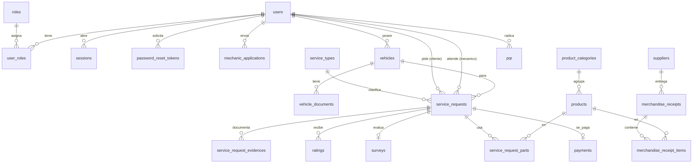

# Modelo de datos

El esquema se crea con las migraciones de `database/migrations/` (seis archivos, uno por área). Todas las tablas usan InnoDB, `utf8mb4` y claves foráneas; los borrados de usuarios, vehículos, solicitudes, encuestas y PQR son lógicos (`deleted_at`).

## Diagrama entidad-relación

## Tablas

| Área | Tablas |
|---|---|
| Identidad y acceso | `roles`, `users`, `user_roles`, `sessions`, `password_reset_tokens` |
| Mecánicos | `mechanic_applications` |
| Vehículos | `vehicles`, `vehicle_documents` |
| Servicios | `service_types`, `service_requests`, `service_request_evidences`, `ratings`, `surveys` |
| Inventario | `product_categories`, `products`, `suppliers`, `merchandise_receipts`, `merchandise_receipt_items`, `service_request_parts` |
| Pagos y soporte | `payments`, `pqr` |

## Normalización (hasta 3FN)

**1FN — valores atómicos, sin grupos repetidos.** Los documentos del vehículo (SOAT, tecnomecánica) no son columnas repetidas `soat_*` / `tecnomecanica_*`: cada uno es una fila de `vehicle_documents` con clave única (vehículo, tipo). Lo mismo con los productos de un ingreso de mercancía (`merchandise_receipt_items`) y los repuestos de un servicio (`service_request_parts`): una fila por producto, nunca listas dentro de una columna.

**2FN — sin dependencias parciales de una clave compuesta.** En las tablas de clave compuesta todos los atributos dependen de la clave completa: en `merchandise_receipt_items (receipt_id, product_id)`, la cantidad y el costo dependen del par (cuánto de *ese* producto llegó en *esa* factura); el nombre del producto o el proveedor no se repiten ahí, viven en `products` y `merchandise_receipts`. Igual en `service_request_parts (service_request_id, product_id)`.

**3FN — sin dependencias transitivas ni datos derivados.**

| Antes (esquema anterior) | Ahora |
|---|---|
| Calificación del cliente como columnas `customer_rating`, `punctuality_rating`, ... dentro de `service_requests`, y la del mecánico en otra tabla | Ambas calificaciones solo en `ratings` (`rating_type` indica el sentido) |
| `resolved_by` repetía al mecánico asignado (`mechanic_id`) | Se eliminó: el mecánico que resolvió es el asignado |
| `surveys.customer_id` repetía el cliente de la solicitud | Se eliminó: se obtiene por `service_request_id` |
| `users.driver_license_status` (vigente / por vencer / vencida) guardado | Se calcula al leer a partir de la fecha de vencimiento |
| `email_verification_status` duplicaba `email_verified_at` | Solo se guarda la fecha (NULL = no verificado) |
| Nombre y precio del servicio como texto libre en cada solicitud | Catálogo `service_types`; la solicitud guarda solo su código (FK) |
| Categoría y proveedor como texto repetido en cada producto / ingreso | Tablas `product_categories` y `suppliers` con FK |
| Estado de disponibilidad del producto guardado | Se deriva de `stock_quantity` frente a `min_stock` |
| Solicitudes de rol con dos parejas revisor/fecha (`reviewed_*`, `approved_*`) y dos notas | Una sola pareja revisor/fecha y una nota en `mechanic_applications` |

**Datos que se guardan a propósito aunque parezcan derivables:**

- `products.stock_quantity` es el saldo actual del producto. Solo lo modifican, dentro de una transacción con la fila bloqueada, los ingresos de mercancía, los ajustes manuales y los repuestos usados en un servicio.
- `service_request_parts.unit_price` es el precio cobrado en ese servicio (precio histórico), que puede diferir del precio actual del producto.
- `payments.amount` es el monto efectivamente cobrado. Una vez existe un pago, el servicio ya no admite repuestos nuevos, así que el monto no se desincroniza.

## Reglas que garantiza la base de datos

- Unicidad: correo y cédula por usuario, una calificación por sentido y servicio, una encuesta y un pago por servicio, una factura por proveedor.
- `CHECK`: puntajes entre 1 y 5, cantidades positivas, datos de tarjeta / PSE solo según el método de pago, revisor y fecha obligatorios en solicitudes revisadas, motivo obligatorio al rechazar.
- Placa y VIN no son únicos en la tabla porque un vehículo eliminado puede volver a registrarse; la unicidad entre vehículos activos la garantiza `VehicleService` con bloqueos de MySQL.
